# Awesome NotebookLM Prompts: Salud 🩺


> Colección **pública, gratuita y colaborativa** de estilos visuales y prompts para generar presentaciones con **NotebookLM** (y alternativas como Kael.im) en el ámbito sanitario: farmacia, medicina, enfermería y educación para la salud.

Pensado para que farmacéuticos, médicos, enfermeros y otros profesionales puedan **reutilizar, adaptar y compartir** diseños: presentar una gama de cosmética, preparar una sesión clínica o diseñar una campaña de farmacia.

## Cómo usarlo

1. Abre tu cuaderno en NotebookLM y añade tus **fuentes** (ficha técnica, prospecto, guía clínica, catálogo...).
2. Entra en **Studio → Presentación de diapositivas** y pulsa el icono de personalizar.
3. **Copia y pega el prompt completo, tal cual** (están en inglés a propósito: es el formato que mejor funciona). Todos incluyen la instrucción `the language should be what users said in the prompt`, así que las diapositivas saldrán en el idioma en que escribas tu petición y tus fuentes.
4. Añade debajo, si quieres, una línea con tu petición en español, por ejemplo: *"Explica a un paciente el uso paso a paso, en 8 diapositivas"*.
5. **Revisa siempre el resultado** con la fuente oficial antes de usarlo con pacientes.

## Qué tienen en común todos los prompts

- Siguen el formato **`design_system`** (el que usan los diseños de NotebookLM/Kael.im): `global_style` (tema, tipografía, paleta en hexadecimal, elementos visuales), `image_generation_prompts` y `slide_layout_templates` con nombre.
- Incluyen la cláusula `the language should be what users said in the prompt` en la tipografía.
- Añaden un bloque `healthcare_rules`: usar solo información de las fuentes, no inventar dosis ni cifras, no mostrar datos de pacientes y añadir el pie "consulta a tu profesional sanitario" en material para pacientes.

> 🎨 **Este repositorio es solo de diseño**: define cómo se ve una presentación, nunca su contenido clínico. Las instrucciones de uso de cada medicamento o producto deben salir siempre de la ficha técnica o del prospecto que cargues como fuente.

> ⚠️ **Aviso importante**: estos prompts controlan el *diseño*, no el *contenido clínico*. La inteligencia artificial puede equivocarse. Verifica dosis, pasos de uso, indicaciones y advertencias con la ficha técnica o la fuente oficial antes de entregar cualquier material. Nunca subas datos identificables de pacientes.

Las imágenes de ejemplo son **solo una guía orientativa**: al usar **IA generativa**, el resultado puede variar entre generaciones, según tus fuentes y con las actualizaciones de NotebookLM. Los estados `sin probar` / `probado` indican si el estilo ya se ha comprobado en NotebookLM con capturas en [images/](images/). ¿Lo has probado? ¡Aporta tus capturas! Consulta [CONTRIBUTING.md](CONTRIBUTING.md).

## Índice

### A. Clínico y profesional
- [Boletín Sanitario](#boletín-sanitario)
- [Minimalismo Clínico](#minimalismo-clínico)
- [Sesión Clínica Minimal](#sesión-clínica-minimal)
- [Guía de Práctica Calm](#guía-de-práctica-calm)
- [Interfaz Web Farmacia](#interfaz-web-farmacia)

### B. Educación al paciente
- [Pediatría Amable](#pediatría-amable)

### C. Producto y cosmética
- [Cosmética Premium Mockup](#cosmética-premium-mockup)
- [Dermocosmética Editorial](#dermocosmética-editorial)
- [Botánico Acuarela](#botánico-acuarela)

### D. Retro y creativos
- [Film Scrapbook](#film-scrapbook)
- [Anatomía Pop](#anatomía-pop)
- [Cuaderno de Enfermería](#cuaderno-de-enfermería)
- [Revista Amarilla Collage](#revista-amarilla-collage)
- [Duotono Números Gigantes](#duotono-números-gigantes)

### F. Personajes e ilustración
- [Monigote Científico](#monigote-científico)
- [Miniatura Tech Divulgación](#miniatura-tech-divulgación)

## A. Clínico y profesional

### Boletín Sanitario

Novedades, alertas y resúmenes para equipos sanitarios y sesiones internas de farmacia u hospital

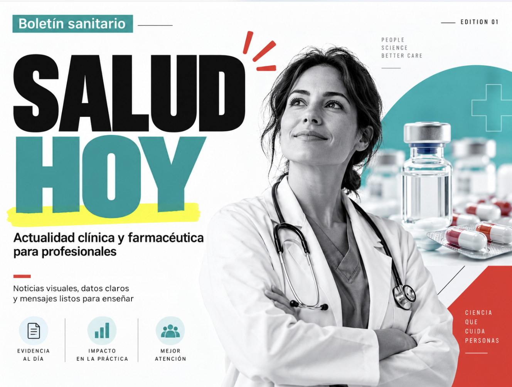 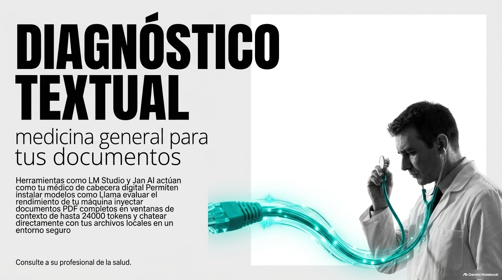 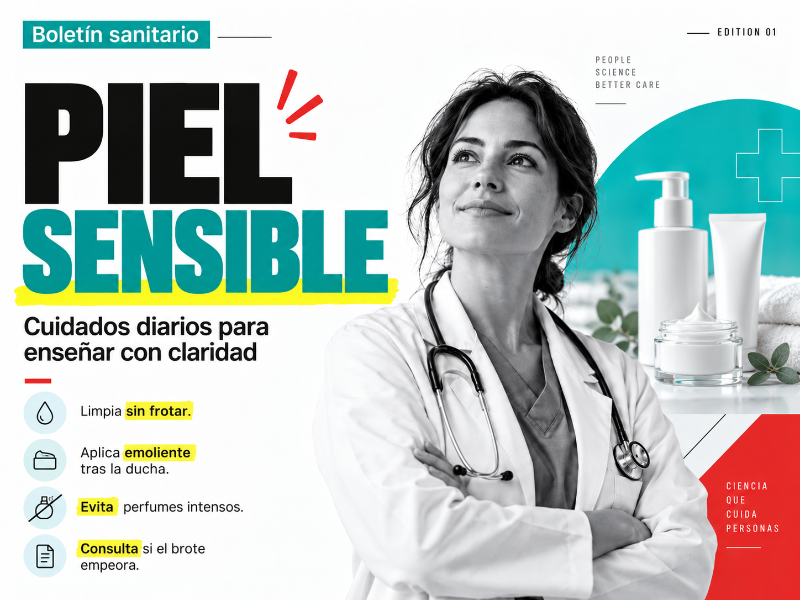 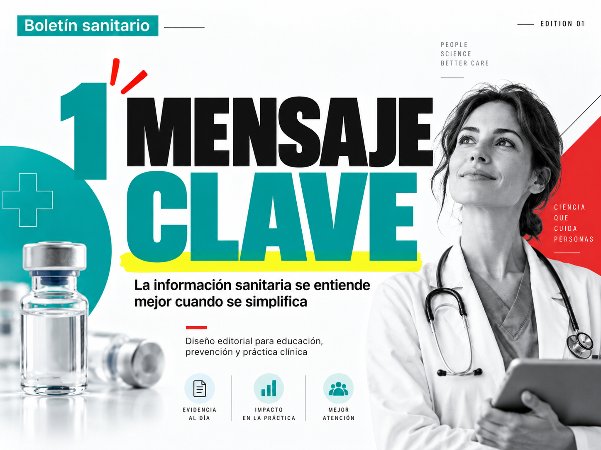

*Imágenes orientativas: al usar IA generativa, el resultado puede variar entre generaciones, según tus fuentes y con las actualizaciones de NotebookLM.*

```yaml
design_system:
  global_style:
    theme: "Modern health newspaper. Smart pop health news, clinical rigor x readability. 1 slide = 1 message."
    typography:
      primary_heading: "Extra-bold sans-serif, ultra-massive (30-50% of the slide), short 2-5 word headlines"
      secondary_heading: "Ultra-thin English sans-serif in the gaps"
      body_text: "Small clean sans-serif, headline-to-body ratio 10:1 or more. No markdown symbols in slide text"
      language: "the language should be what users said in the prompt"
    color_palette:
      background: "#FFFFFF or cool gray #F5F5F5"
      text_main: "#111111"
      primary_color: "#00A19B"
      accent_color: "#E5322D"
      highlight: "#FFE14D marker lines behind key numbers"
    key_visual_elements:
      - "Asymmetric Swiss grid, title far top-left or bottom-left"
      - "Monochrome cutouts of healthcare professionals"
      - "Clean photos of medicines and devices on blown-out backgrounds"
      - "Fluorescent marker highlights"

slide_layout_templates:
  - type: "Asymmetric_Cover"
    usage: "Huge short title with a tiny benefit-driven subtitle"
  - type: "Giant_Number"
    usage: "One key figure from the sources at massive scale"
  - type: "Text_Void_Contrast"
    usage: "Packed text on one half, empty space on the other"
  - type: "Punchline_Center"
    usage: "Key takeaway in the center or bleeding off the edge"

healthcare_rules: "Use only the provided sources. Never invent doses, indications or figures; leave a marked blank if data is missing. No real patient data. Patient-facing slides end with a small footer: Consult your healthcare professional (in the user's language)."
```
*Estado: sin probar · Archivo: [01-boletin-sanitario.md](prompts/01-boletin-sanitario.md) · Inspirado en: Modern Newspaper (https://x.com/mmmiyama_D/status/1998528702150488069) vía awesome-notebookLM-prompts · Adaptación: Mantenedores del repositorio*

### Minimalismo Clínico

Sesiones clínicas, protocolos y presentaciones formales con mucho espacio en blanco

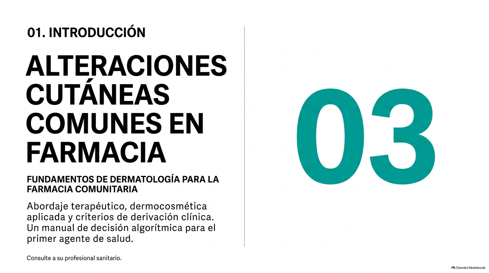 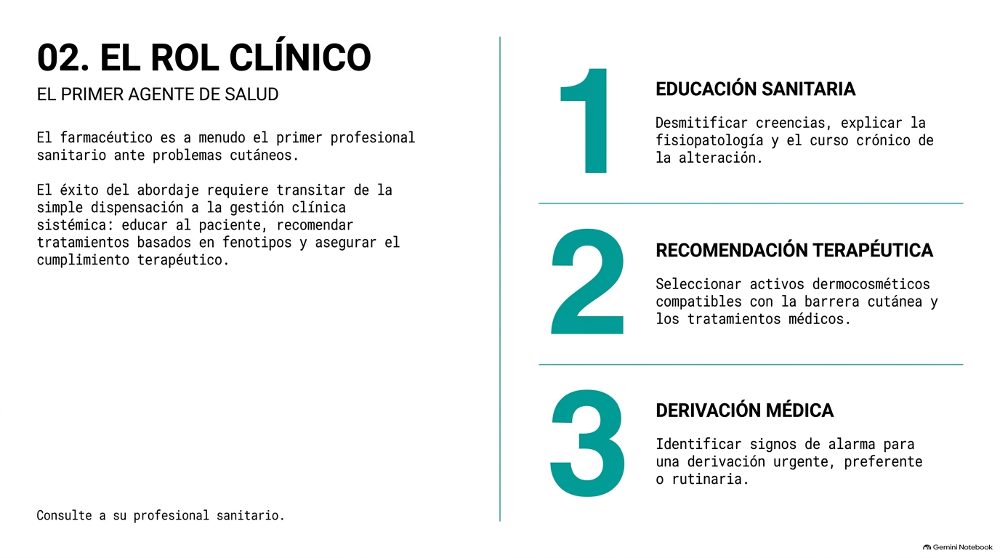 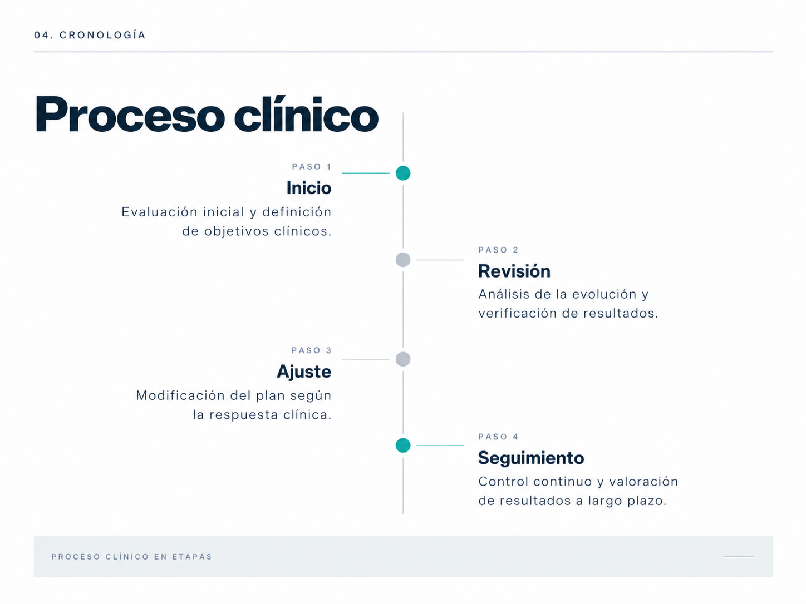 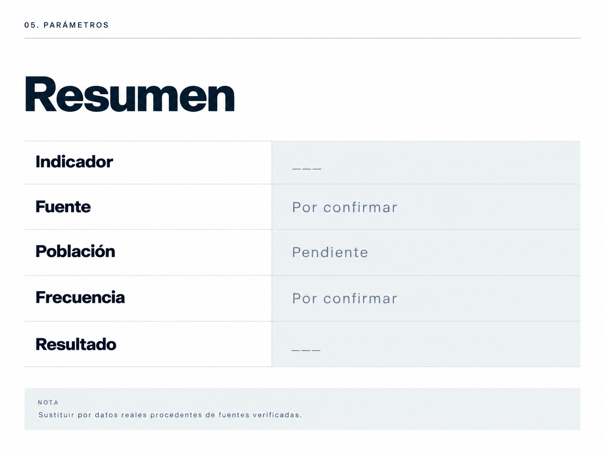

*Imágenes orientativas: al usar IA generativa, el resultado puede variar entre generaciones, según tus fuentes y con las actualizaciones de NotebookLM.*

```yaml
design_system:
  global_style:
    theme: "Sharp-edged clinical minimalism. Architectural, grid-based, aesthetics of whitespace."
    typography:
      primary_heading: "Inter / Helvetica Now bold, English, with a small section label such as 01. INTRODUCTION top-left"
      secondary_heading: "Small caps labels"
      body_text: "Small sans-serif with generous letter spacing and line height"
      language: "the language should be what users said in the prompt"
    color_palette:
      background: "#FFFFFF"
      surface: "#EEF2F3"
      text_main: "#0B1F2A"
      primary_color: "#00A19B"
      dark_mode: "#0B1F2A for emphasis slides"
    key_visual_elements:
      - "Strict grid with large empty areas"
      - "Hairline dividers and oversized teal key figures"
      - "Wireframe diagrams, thin white lines on dark"
      - "Desaturated clinical photography with tiny captions"

slide_layout_templates:
  - type: "Text_Data_Split"
    usage: "Narrative left, oversized teal figure right, thin divider"
  - type: "Photo_List_Split"
    usage: "50:50 photo and bold-heading list with light descriptions"
  - type: "Decision_Flow"
    usage: "Clinical algorithm with thin lines, yes/no branches, one sentence per node"
  - type: "Vertical_Timeline"
    usage: "Thin vertical line with text branching left and right"
  - type: "Parameter_Table"
    usage: "Hairline rows, bold names left, large light values right"
  - type: "Dark_Mode_Diagram"
    usage: "Dark background, thin white lines connecting nodes"

healthcare_rules: "Use only the provided sources. Never invent doses, indications or figures; leave a marked blank if data is missing. No real patient data. Patient-facing slides end with a small footer: Consult your healthcare professional (in the user's language)."
```
*Estado: sin probar · Archivo: [02-minimalismo-clinico.md](prompts/02-minimalismo-clinico.md) · Inspirado en: Sharp-edged Minimalism (https://x.com/yoshifujidesign/status/1997878247322001626) vía awesome-notebookLM-prompts · Adaptación: Mantenedores del repositorio*

### Sesión Clínica Minimal

Sesiones y charlas con poco texto y mucho impacto visual

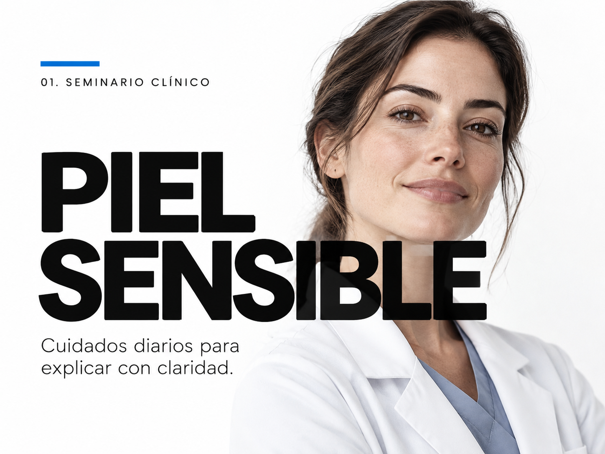 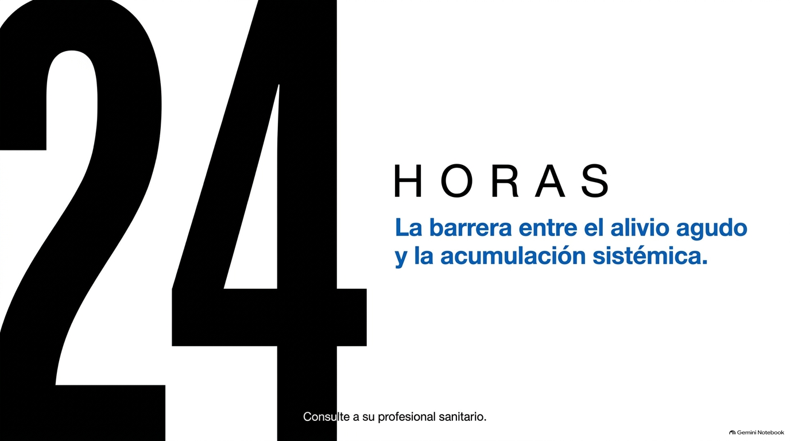 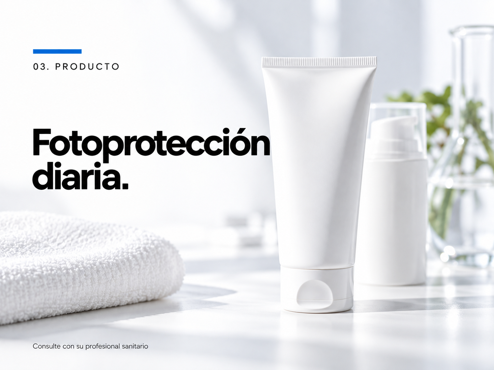 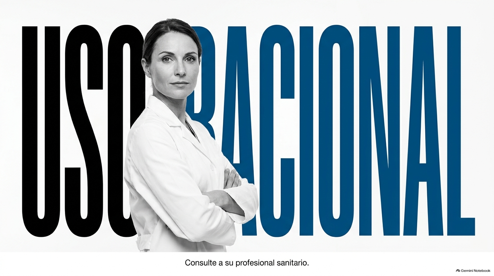 

*Imágenes orientativas: al usar IA generativa, el resultado puede variar entre generaciones, según tus fuentes y con las actualizaciones de NotebookLM.*

```yaml
design_system:
  global_style:
    theme: "Minimal-text clinical seminar. Editorial, confident, one idea per slide."
    typography:
      primary_heading: "Large dynamic sans-serif, tight tracking, mixed scale"
      secondary_heading: "Small uppercase labels"
      body_text: "Light clean sans-serif, maximum two short lines per slide"
      language: "the language should be what users said in the prompt"
    color_palette:
      background: "#FFFFFF"
      text_main: "#111111"
      primary_color: "#0072CE"
      accent_color: "#0072CE used once per slide"
    key_visual_elements:
      - "High-quality editorial portraits of healthcare professionals"
      - "Clean photography of medical products"
      - "Oversized typography overlapping photos"
      - "Lots of white space"

slide_layout_templates:
  - type: "Portrait_Cover"
    usage: "Editorial portrait with oversized overlapping title"
  - type: "One_Sentence"
    usage: "A single sentence in large type with abundant white space"
  - type: "Photo_Full_Bleed"
    usage: "Full-slide photo with one short caption"
  - type: "Number_Focus"
    usage: "One figure from the sources in huge type with a thin label"

healthcare_rules: "Use only the provided sources. Never invent doses, indications or figures; leave a marked blank if data is missing. No real patient data. Patient-facing slides end with a small footer: Consult your healthcare professional (in the user's language)."
```
*Estado: sin probar · Archivo: [03-sesion-clinica-minimal.md](prompts/03-sesion-clinica-minimal.md) · Inspirado en: For Seminar Use, Minimal Text (Kawai, https://x.com/kawai_design) vía awesome-notebookLM-prompts · Adaptación: Mantenedores del repositorio*

### Guía de Práctica Calm

Protocolos, guías de práctica clínica y procedimientos normalizados de trabajo

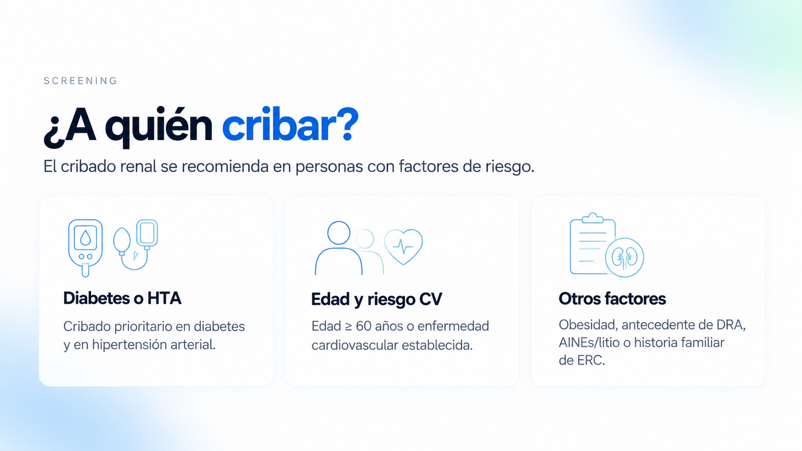 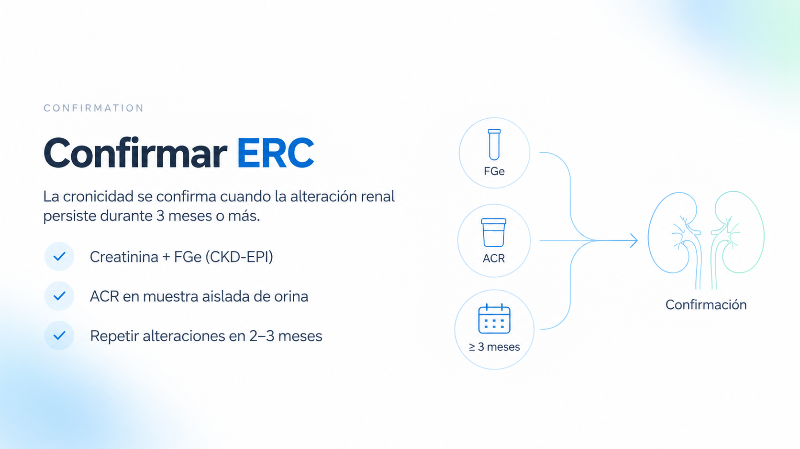 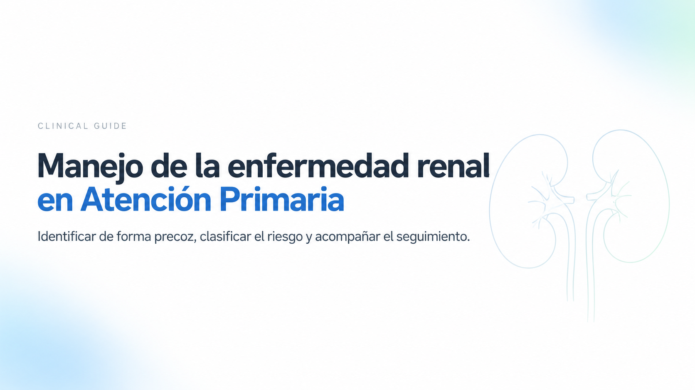 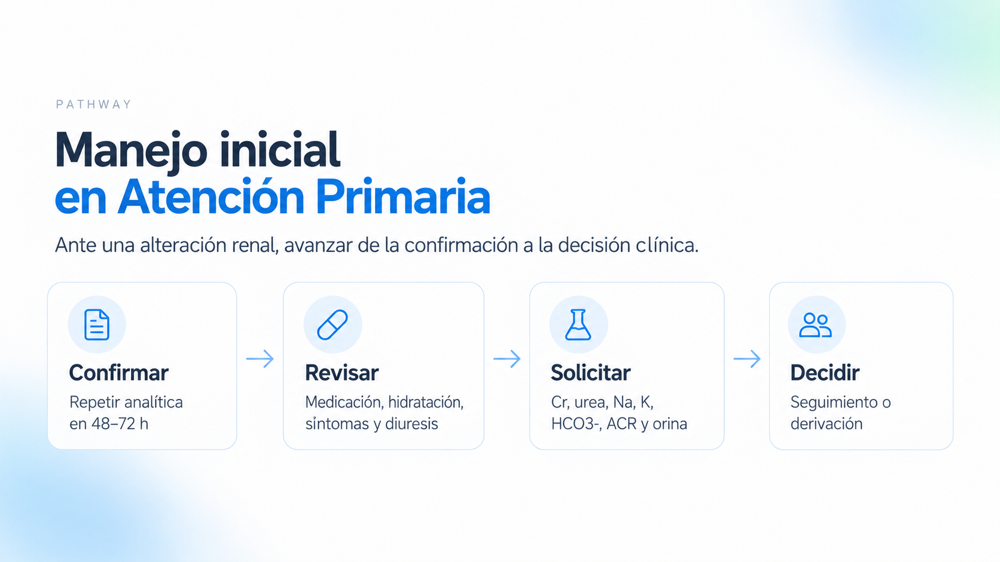

*Imágenes orientativas: al usar IA generativa, el resultado puede variar entre generaciones, según tus fuentes y con las actualizaciones de NotebookLM.*

```yaml
design_system:
  global_style:
    theme: "Calm clinical practice. A living protocol: complexity becoming clear steps. Airy, no visual noise."
    typography:
      primary_heading: "Clean modern rounded sans-serif, medium-bold, calm authority"
      secondary_heading: "Small light English labels"
      body_text: "Clean sans-serif, one concise sentence under each headline, no long paragraphs"
      language: "the language should be what users said in the prompt"
    color_palette:
      background: "#FFFFFF"
      text_main: "#1B2631"
      primary_color: "#0072CE"
      gradient: "very low-opacity blue to cyan to mint on corners only, never behind text"
    key_visual_elements:
      - "Thin-line outline icons (cross, stethoscope, checklist, syringe)"
      - "Soft rounded cards with subtle shadows"
      - "Dense list turning into a clean checklist or pathway"
      - "Left-aligned layouts with wide margins"

slide_layout_templates:
  - type: "Calm_Cover"
    usage: "Left-aligned headline, one sentence, soft corner gradient"
  - type: "Text_Left_Visual_Right"
    usage: "One idea per slide with a thin-line diagram"
  - type: "Three_Column_Cards"
    usage: "Icon, title and 1-2 lines per card"
  - type: "Pathway_Flow"
    usage: "Sequential steps with directional arrows"

avoid: "pixel art, thick borders, bright blocks, collage, stickers, emojis, hype language"

healthcare_rules: "Use only the provided sources. Never invent doses, indications or figures; leave a marked blank if data is missing. No real patient data. Patient-facing slides end with a small footer: Consult your healthcare professional (in the user's language)."
```
*Estado: sin probar · Archivo: [04-guia-practica-calm.md](prompts/04-guia-practica-calm.md) · Inspirado en: Anti-Gravity / Living Artifact (awesome-notebookLM-prompts) · Adaptación: Mantenedores del repositorio*

### Interfaz Web Farmacia

Presentar herramientas digitales, catálogos, consultas y proyectos de farmacia con aspecto de producto web moderno

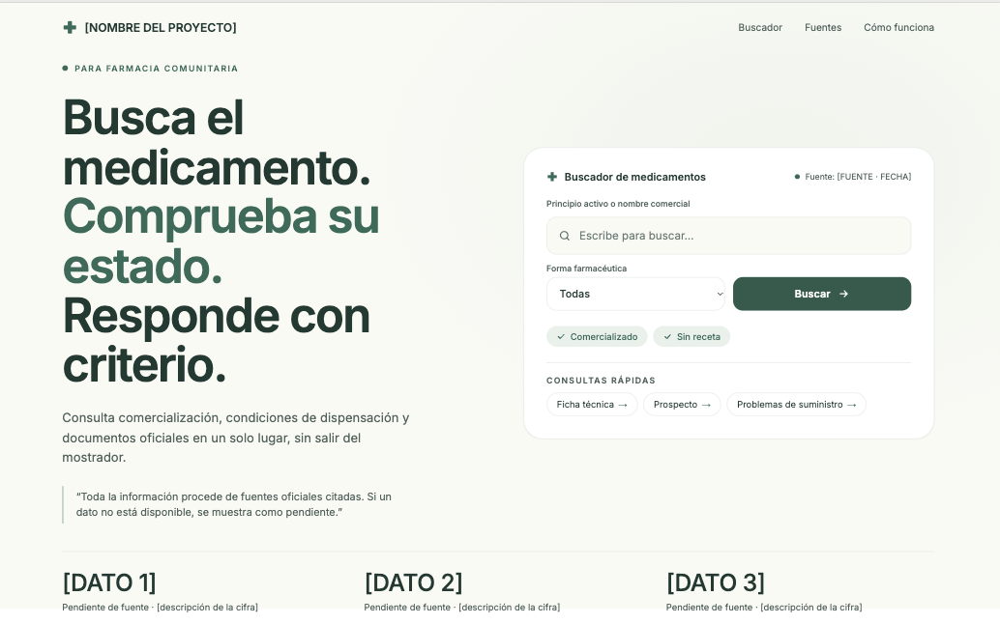

*Imágenes orientativas: al usar IA generativa, el resultado puede variar entre generaciones, según tus fuentes y con las actualizaciones de NotebookLM.*

```yaml
design_system:
  global_style:
    theme: "Clean healthcare product landing page. Calm, trustworthy, modern SaaS. Generous whitespace, soft rounded cards, one confident green accent."
    typography:
      primary_heading: "Large tight-tracking sans-serif (Inter / Helvetica Now), 3 short lines, the middle line in green"
      secondary_heading: "Small uppercase letter-spaced labels with a green dot, e.g. FOR COMMUNITY PHARMACY"
      body_text: "Regular gray-green sans-serif, 1-2 short lines, one quoted note with a thin left rule"
      numbers: "Medium-weight figures with a small caption underneath"
      language: "the language should be what users said in the prompt"
    color_palette:
      background: "#FAFAF5 warm off-white with a very soft green haze"
      text_main: "#1F3A33 deep green-black"
      primary: "#2F6B58 forest green"
      button: "#2D5B4C"
      surface: "#FFFFFF cards with a thin #E3E8E2 border"
      chip: "#E9F0EA pale green"
    key_visual_elements:
      - "Big rounded white card with a thin outline showing a clean interface: search field, dropdown, dark green button with an arrow"
      - "Pill chips with check marks (e.g. Marketed, No prescription)"
      - "Quick-query chips with small arrows"
      - "Three key figures in a row with captions and a thin divider above"
      - "Tiny green cross icon and dot in the card header"

slide_layout_templates:
  - type: "Landing_Hero"
    usage: "Three-line headline and subtitle on the left, interface card on the right, chips and figures below"
  - type: "Feature_Cards"
    usage: "Three rounded cards, each with a small icon, title and one sentence"
  - type: "Key_Figures"
    usage: "Three large figures from the sources with captions and a thin divider"
  - type: "Interface_Mockup"
    usage: "Large card with a simplified UI relevant to the topic, with a green call-to-action button"
  - type: "Data_Source_Note"
    usage: "Soft gray-green note box stating where the data comes from"

avoid: "dark backgrounds, bright neon colors, heavy shadows, clip art, busy screenshots, invented statistics or product names"

healthcare_rules: "Use only the provided sources. Never invent doses, indications or figures; leave a marked blank if data is missing. No real patient data. Patient-facing slides end with a small footer: Consult your healthcare professional (in the user's language)."
```
*Estado: sin probar · Archivo: [16-interfaz-web-farmacia.md](prompts/16-interfaz-web-farmacia.md) · Inspirado en: Estilo de landing page de producto sanitario verde sobre blanco roto (captura aportada por la persona que mantiene el repositorio) · Adaptación: Mantenedores del repositorio*

## B. Educación al paciente

### Pediatría Amable

Niños y familias; explicar procedimientos, vacunas o hábitos de forma amigable

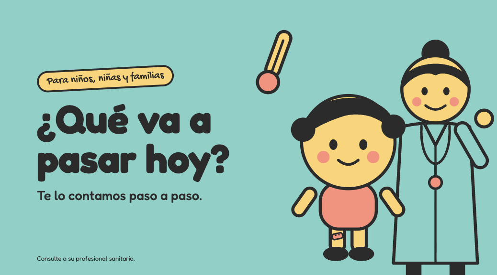

*Imágenes orientativas: al usar IA generativa, el resultado puede variar entre generaciones, según tus fuentes y con las actualizaciones de NotebookLM.*

```yaml
design_system:
  global_style:
    theme: "Friendly flat pediatric style. Calm, reassuring, playful but never babyish. One short sentence per slide."
    typography:
      primary_heading: "Very large rounded sans-serif"
      secondary_heading: "Handwritten-style accent labels"
      body_text: "Rounded sans-serif in words a 7-year-old understands"
      language: "the language should be what users said in the prompt"
    color_palette:
      background: "one solid flat color per slide"
      primary_color: "#7FD1C7"
      secondary: "#FFD36E"
      accent_color: "#FF8E7A"
      text_main: "#2B2B2B"
    key_visual_elements:
      - "Slightly deformed child and friendly healthcare professional"
      - "Thick outlines, flat colors, up to 3 colors per slide"
      - "Round kind faces, never scary"
      - "Stethoscope, thermometer, plaster drawn as cute simple shapes"

slide_layout_templates:
  - type: "Character_Cover"
    usage: "Large character with big rounded title"
  - type: "Story_Step"
    usage: "One illustrated step with one short sentence"
  - type: "Brave_Badge_Ending"
    usage: "Sticker-style badge, no promises about pain unless in the sources"

healthcare_rules: "Use only the provided sources. Never invent doses, indications or figures; leave a marked blank if data is missing. No real patient data. Patient-facing slides end with a small footer: Consult your healthcare professional (in the user's language)."
```
*Estado: sin probar · Archivo: [05-pediatria-amable.md](prompts/05-pediatria-amable.md) · Inspirado en: Deformed Flat Persona (Kawai, https://x.com/kawai_design) vía awesome-notebookLM-prompts · Adaptación: Mantenedores del repositorio*

## C. Producto y cosmética

### Cosmética Premium Mockup

Presentar productos cosméticos y dermocosméticos a clientes, equipo de farmacia o proveedores

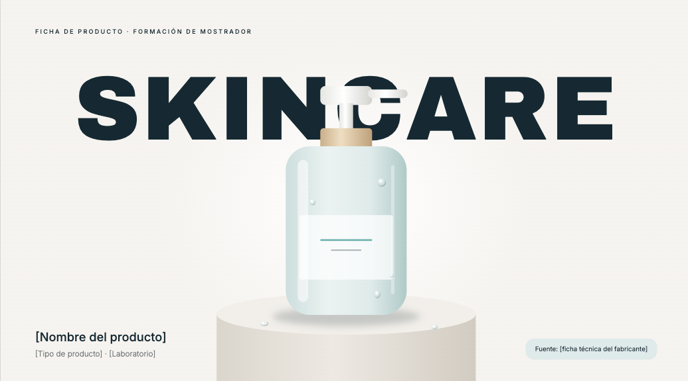

*Imágenes orientativas: al usar IA generativa, el resultado puede variar entre generaciones, según tus fuentes y con las actualizaciones de NotebookLM.*

```yaml
design_system:
  global_style:
    theme: "Premium clean-beauty packshot. Refined, professional, showcase in perfection."
    typography:
      primary_heading: "Elegant blocky sans-serif or high-contrast serif, English large"
      secondary_heading: "Small subtitle in the user's language"
      body_text: "Thin gray sans-serif"
      language: "the language should be what users said in the prompt"
    color_palette:
      background: "#FFFFFF or warm #F6F3EF"
      dark_slides: "#0F2A33"
      primary_color: "#00A19B"
      accent_color: "#E8C9A0 champagne"
      surface: "#DCEBEA"
    key_visual_elements:
      - "3D packshots of generic tubes, pump bottles and jars on light stone podiums"
      - "Water droplets, soft shadows and glass reflections"
      - "Product as hero, partly cropped by the edge"
      - "Rounded cards for active ingredients"

slide_layout_templates:
  - type: "Hero_Product"
    usage: "Centered product on a podium with ultra-bold title"
  - type: "Active_Ingredients_Cards"
    usage: "One rounded card per ingredient from the sources"
  - type: "Split_Numbers"
    usage: "Large figures from the sources left, description right"
  - type: "How_To_Use"
    usage: "Three or four numbered steps with line icons, only from the sources"
  - type: "Precautions_Card"
    usage: "Small card with precautions exactly as in the sources"

avoid: "invented claims, percentages, certifications, brand logos"

healthcare_rules: "Use only the provided sources. Never invent doses, indications or figures; leave a marked blank if data is missing. No real patient data. Patient-facing slides end with a small footer: Consult your healthcare professional (in the user's language)."
```
*Estado: sin probar · Archivo: [06-cosmetica-premium-mockup.md](prompts/06-cosmetica-premium-mockup.md) · Inspirado en: Studio / Mockup / Premium (https://note.com/yoshifujidesign/n/n7412bccb5762) vía awesome-notebookLM-prompts · Adaptación: Mantenedores del repositorio*

### Dermocosmética Editorial

Campañas de farmacia, consejos de cuidado de la piel y presentaciones de gama

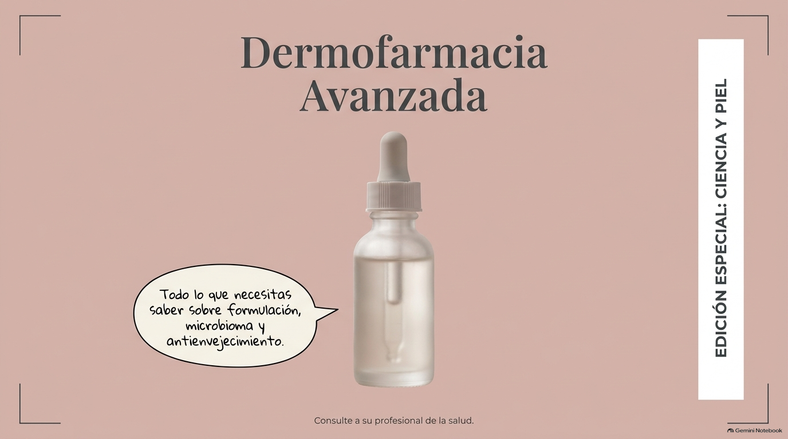 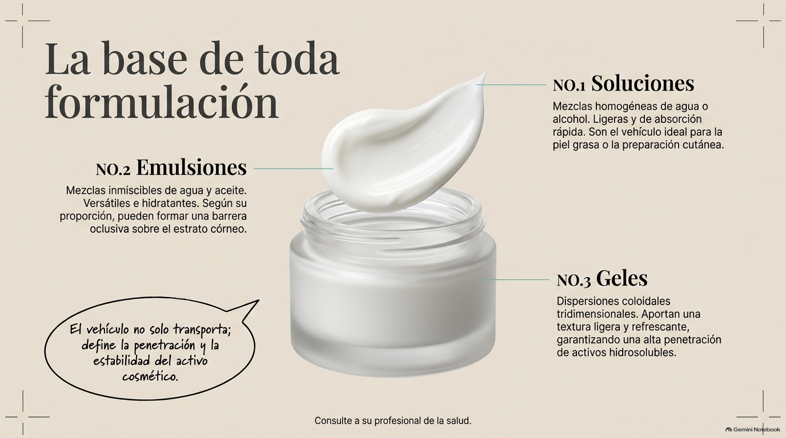 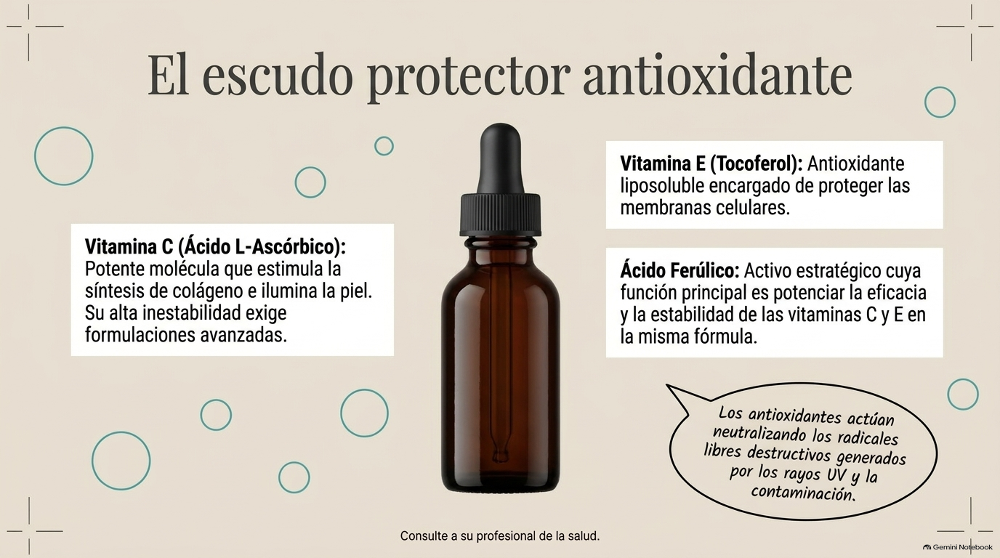

*Imágenes orientativas: al usar IA generativa, el resultado puede variar entre generaciones, según tus fuentes y con las actualizaciones de NotebookLM.*

```yaml
design_system:
  global_style:
    theme: "Sophisticated skincare magazine. Mature-cute, feminine, trendy, polished and trustworthy."
    typography:
      primary_heading: "Sophisticated gothic sans-serif or elegant serif"
      secondary_heading: "Hand-drawn font for comments and bubbles"
      body_text: "Clean small sans-serif"
      language: "the language should be what users said in the prompt"
    color_palette:
      background: "#EBD3CF dusty blush, matte"
      text_main: "#2F2F33"
      secondary: "#FFFFFF"
      accent_color: "#00A19B"
    key_visual_elements:
      - "Large deep-etched cutout of the product in the center"
      - "Hand-drawn speech bubbles asymmetrically in the margins"
      - "Small numbered sections NO.1, NO.2"
      - "Vertical white text box at the edge and L-shaped crop marks in the corners"

slide_layout_templates:
  - type: "Magazine_Cover"
    usage: "Central cutout product, asymmetric bubbles, catchy vertical line"
  - type: "Numbered_Advice"
    usage: "Main points as NO.1, NO.2 sections around the product"
  - type: "Ingredient_Spotlight"
    usage: "One ingredient from the sources in a white box with a hand-drawn arrow"

avoid: "childish vivid colors, flashy gradients, heavy shadows, miracle or guaranteed claims"

healthcare_rules: "Use only the provided sources. Never invent doses, indications or figures; leave a marked blank if data is missing. No real patient data. Patient-facing slides end with a small footer: Consult your healthcare professional (in the user's language)."
```
*Estado: sin probar · Archivo: [07-dermocosmetica-editorial.md](prompts/07-dermocosmetica-editorial.md) · Inspirado en: Magazine style (https://x.com/tetumemo/status/1996930284500201685) vía awesome-notebookLM-prompts · Adaptación: Mantenedores del repositorio*

### Botánico Acuarela

Fitoterapia, productos naturales, plantas medicinales y gamas de cosmética natural

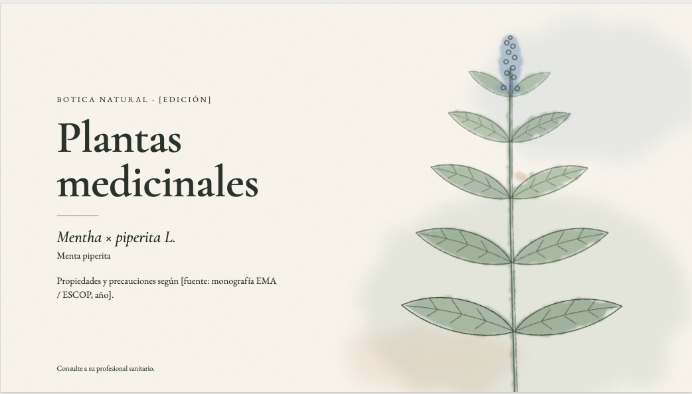

*Imágenes orientativas: al usar IA generativa, el resultado puede variar entre generaciones, según tus fuentes y con las actualizaciones de NotebookLM.*

```yaml
design_system:
  global_style:
    theme: "Botanical watercolor apothecary. Wet watercolor washes, calm, natural, artistic."
    typography:
      primary_heading: "Readable elegant serif"
      secondary_heading: "Italic serif for plant names"
      body_text: "Clean serif or light sans-serif on calm areas only"
      language: "the language should be what users said in the prompt"
    color_palette:
      background: "#FBF7EF watercolor paper"
      primary_color: "#7A9E7E"
      secondary: "#2F6FA3"
      accent_color: "#C98B5E"
      text_main: "#26332B"
    key_visual_elements:
      - "Wet-on-wet watercolor with soft bleeding edges"
      - "Botanical illustrations of medicinal plants with thin ink contours"
      - "Paper grain texture"
      - "Plenty of white space, text never over busy paint"

slide_layout_templates:
  - type: "Botanical_Cover"
    usage: "Large painted plant with title on a calm area"
  - type: "Plant_Profile"
    usage: "One plant per slide, properties and precautions exactly as in the sources"
  - type: "Herb_Grid"
    usage: "Several small plant paintings with short labels"

healthcare_rules: "Use only the provided sources. Never invent doses, indications or figures; leave a marked blank if data is missing. No real patient data. Patient-facing slides end with a small footer: Consult your healthcare professional (in the user's language)."
```
*Estado: sin probar · Archivo: [08-botanico-acuarela.md](prompts/08-botanico-acuarela.md) · Inspirado en: Royal Blue and Red watercolor (https://x.com/kottley/status/1994442047579721782) vía awesome-notebookLM-prompts · Adaptación: Mantenedores del repositorio*

## D. Retro y creativos

### Film Scrapbook

Historias, biografías, casos narrados, historia de la farmacia y presentaciones tipo documental

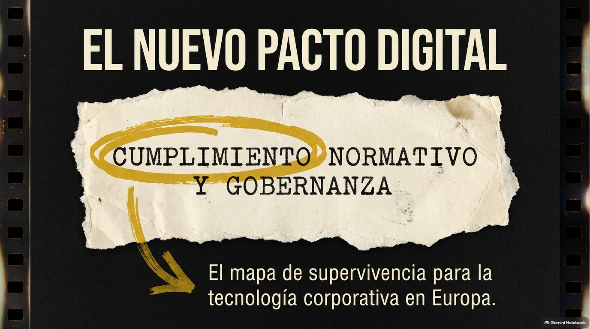 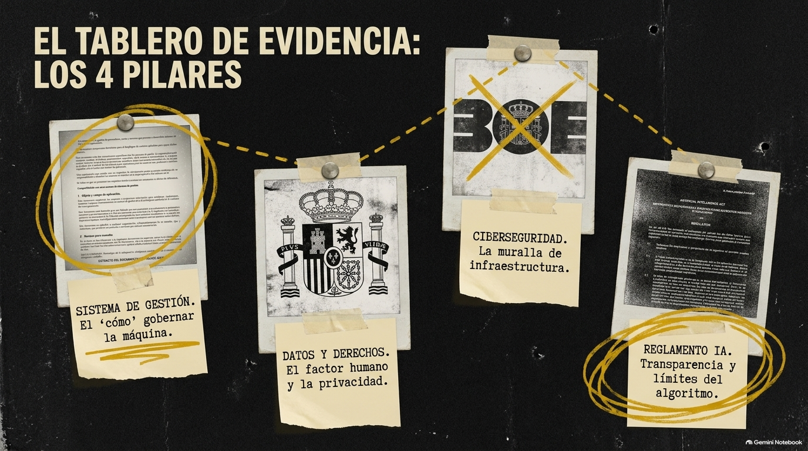 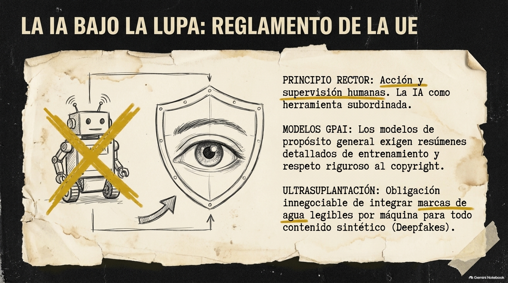

*Imágenes orientativas: al usar IA generativa, el resultado puede variar entre generaciones, según tus fuentes y con las actualizaciones de NotebookLM.*

```yaml
description: "A tactile and nostalgic aesthetic designed for storytelling, biographies, and documentary-style presentations. It pairs the clean Open Sauce sans-serif with the technical Fira Code monospace. Characterized by a charcoal black and cream palette, it features film strip borders, ripped paper textures, and hand-drawn mustard yellow highlights to create a personal, 'behind-the-scenes' scrapbook atmosphere."

design_system:
  global_style:
    theme: "Film Scrapbook. Personal and nostalgic design with film textures and hand-drawn highlights."
    typography:
      primary_heading: "Open Sauce, sans-serif"
      secondary_heading: "Fira Code, monospace"
      body_text: "Fira Code, regular"
      language: "the language should be what users said in the prompt"
    color_palette:
      primary: "#C0CA33" # Mustard Yellow Highlight
      secondary: "#F5F5DC" # Old Paper Cream
      background: "#121212" # Charcoal Black
      surface: "#F5F5DC" # Cream Surface for paper notes
      text_main: "#F5F5DC" # Cream text on dark
      text_secondary: "#121212" # Dark text on paper
    key_visual_elements:
      - "Vertical film strip borders and vintage camera reel motifs"
      - "Ripped paper textures used as containers for secondary text"
      - "Hand-drawn mustard yellow circles and underlines to emphasize words"
      - "Simple doodle-style icons (smileys, arrows, stars) in yellow and white"

  image_generation_prompts:
    style_guidelines: "Vintage film scrapbook aesthetic, charcoal black and cream palette, film strips, ripped paper, hand-drawn yellow circles, Fira Code font vibe, grainy documentary atmosphere."
    themes:
      - target: "Story Introduction"
        prompt_elements: "A vintage film strip on the side of a charcoal black background, a piece of ripped cream paper in the center, hand-drawn yellow arrow."
      - target: "Historical Context"
        prompt_elements: "A grainy black and white photo framed like a polaroid, mustard yellow scribbles, old paper texture."

slide_layout_templates:
  - type: "Scrapbook_Title"
    usage: "Title in Open Sauce on black with film strips on the edges and a hand-drawn circle around a key word"
  - type: "Ripped_Note_Slide"
    usage: "Body text in Fira Code placed over a large ripped paper graphic in the center"
  - type: "Film_Strip_Gallery"
    usage: "Multiple photos arranged as if they were part of a continuous film reel"
  - type: "Doodle_Resource_Page"
    usage: "Icons and links surrounded by hand-drawn scribbles and smiley faces on a cream background"

healthcare_rules: "Use only the provided sources. Never invent doses, indications or figures; leave a marked blank if data is missing. No real patient data. Patient-facing slides end with a small footer: Consult your healthcare professional (in the user's language)."
```
*Estado: sin probar · Archivo: [09-film-scrapbook.md](prompts/09-film-scrapbook.md) · Inspirado en: Film Scrapbook (ejemplo de design_system aportado por la persona que mantiene el repositorio) · Adaptación: Mantenedores del repositorio*

### Anatomía Pop

Formación creativa, divulgación del cuerpo humano, cursos y jornadas con tono desenfadado

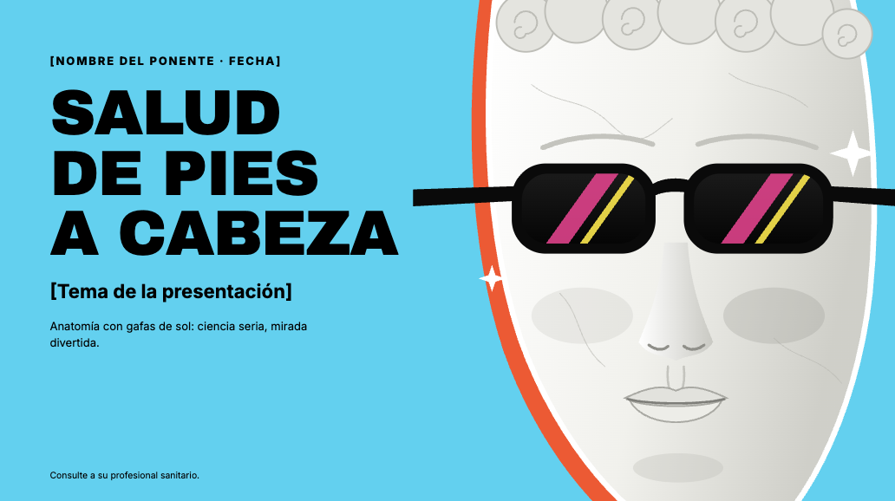

*Imágenes orientativas: al usar IA generativa, el resultado puede variar entre generaciones, según tus fuentes y con las actualizaciones de NotebookLM.*

```yaml
design_system:
  global_style:
    theme: "Anatomical model pop art. Marble busts and plaster models x neon pop gadgets, humorous and surreal."
    typography:
      primary_heading: "Ultra-bold sans-serif"
      secondary_heading: "Bold sans-serif subheads"
      body_text: "Clean sans-serif"
      language: "the language should be what users said in the prompt"
    color_palette:
      background: "solid saturated color changing each slide: cyan #19D3F3, magenta #FF2E93, yellow #FFE600, lime #B6FF00"
      text_main: "white or black, highest contrast"
      accent_color: "complementary to the background"
    key_visual_elements:
      - "White marble busts and plaster skull, heart, lungs, hand"
      - "Sunglasses, headphones, masks, smartphones, sneakers"
      - "Sharp clean cutouts"
      - "Never reuse the same model on two slides"

slide_layout_templates:
  - type: "Pop_Cover"
    usage: "Bust with sunglasses in extreme close-up"
  - type: "Organ_Spotlight"
    usage: "One organ with pop accessories and a bubble with a point from the sources"
  - type: "Split_Duality"
    usage: "Two color halves, bust holding a different object in each hand"
  - type: "QR_Closing"
    usage: "Bust holding a QR code panel"

avoid: "real patients, mocking illnesses or disabilities"

healthcare_rules: "Use only the provided sources. Never invent doses, indications or figures; leave a marked blank if data is missing. No real patient data. Patient-facing slides end with a small footer: Consult your healthcare professional (in the user's language)."
```
*Estado: sin probar · Archivo: [10-anatomia-pop.md](prompts/10-anatomia-pop.md) · Inspirado en: Classic / Pop, Sculpture x Vaporwave (https://note.com/yoshifujidesign/n/n7412bccb5762) vía awesome-notebookLM-prompts · Adaptación: Mantenedores del repositorio*

### Cuaderno de Enfermería

Apuntes, resúmenes de estudio, formación y sesiones con aspecto de cuaderno

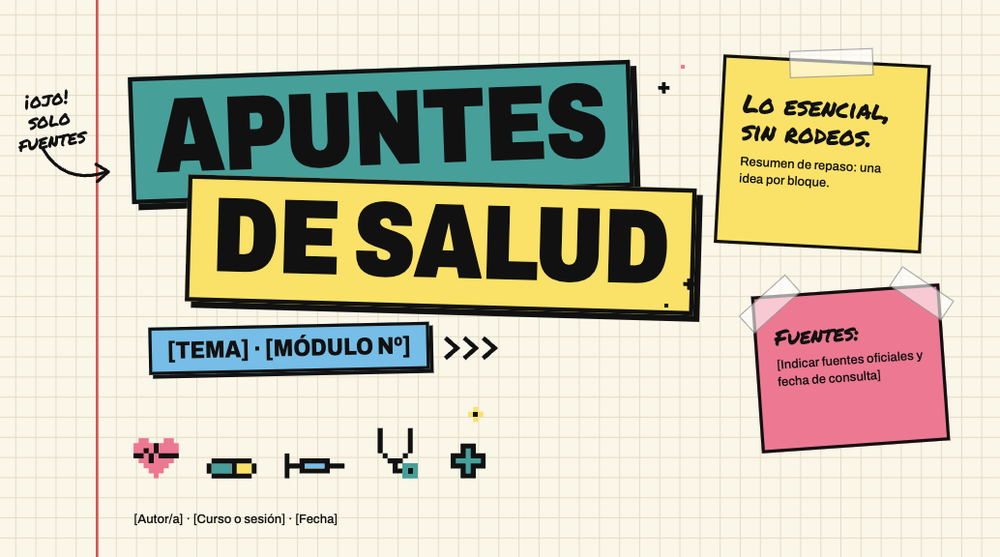

*Imágenes orientativas: al usar IA generativa, el resultado puede variar entre generaciones, según tus fuentes y con las actualizaciones de NotebookLM.*

```yaml
design_system:
  global_style:
    theme: "Neo-retro health notebook. Annotated study notes, controlled imperfection, assembled not aligned."
    typography:
      primary_heading: "Bold heavy slightly condensed geometric sans-serif"
      secondary_heading: "Marker handwriting for margin notes"
      body_text: "Medium sans-serif captions"
      language: "the language should be what users said in the prompt"
    color_palette:
      background: "#FBF6E6 cream grid paper with a red margin line"
      text_main: "#111111"
      primary_color: "#00A19B"
      secondary: "#FFE14D"
      tertiary: "#5BC0EB"
      alert: "#FF6F91"
      borders: "thick black outlines"
    key_visual_elements:
      - "Stacked blocks with thick black borders and slight overlaps"
      - "Sticky notes and tape on corners"
      - "8-bit pixel icons: syringe, pill, heart pulse, stethoscope, cross"
      - "Arrows, chevrons and pixel sparks"

slide_layout_templates:
  - type: "Notebook_Cover"
    usage: "Huge title block on grid paper with sticky notes"
  - type: "Mechanism_Layers"
    usage: "Stacked colored layers with icon, title and one line"
  - type: "Steps_Procedure"
    usage: "Left-to-right boxes, last step larger"
  - type: "Mnemonic_Cheat_Sheet"
    usage: "Big acronym in a boxed frame, meaning per letter"
  - type: "Red_Flags"
    usage: "Coral blocks with warning list exactly as in the sources"

avoid: "gradients, realistic photos, soft shadows, corporate templates"

healthcare_rules: "Use only the provided sources. Never invent doses, indications or figures; leave a marked blank if data is missing. No real patient data. Patient-facing slides end with a small footer: Consult your healthcare professional (in the user's language)."
```
*Estado: sin probar · Archivo: [11-cuaderno-enfermeria.md](prompts/11-cuaderno-enfermeria.md) · Inspirado en: Neo-Retro Dev Deck / Pixel-Infographic Editorial (awesome-notebookLM-prompts) · Adaptación: Mantenedores del repositorio*

### Revista Amarilla Collage

Novedades normativas, reglas de dispensación y formación de equipo con tono de revista de moda y collage

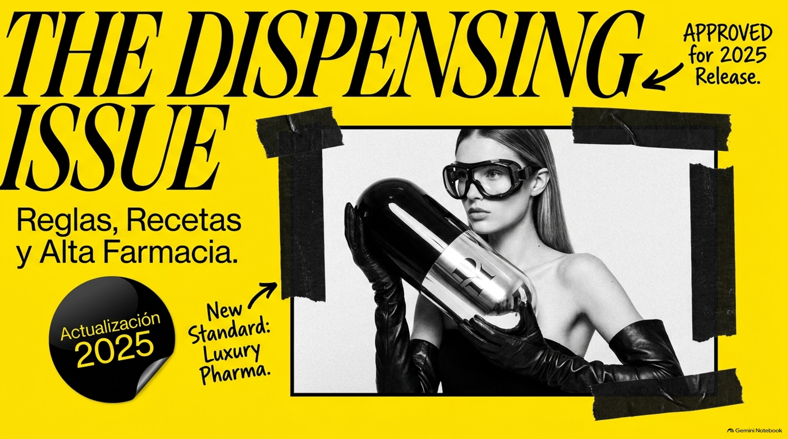

*Imágenes orientativas: al usar IA generativa, el resultado puede variar entre generaciones, según tus fuentes y con las actualizaciones de NotebookLM.*

```yaml
design_system:
  global_style:
    theme: "High-fashion magazine collage. Bold, irreverent, editorial scrapbook. Dense rules become punchy, scannable pages."
    typography:
      primary_heading: "Ultra-condensed high-contrast display serif, black, tightly stacked, very large, italic on covers"
      secondary_heading: "Handwritten marker script for notes, arrows and stickers"
      body_text: "Bold condensed sans-serif in black boxes with white text, or on white paper strips"
      language: "the language should be what users said in the prompt"
    color_palette:
      background: "#F7E03C saturated yellow on every slide"
      ink: "#111111"
      paper: "#FFFFFF torn paper and polaroid frames"
      accent_color: "#C0452B used only for a cover frame or alerts"
    key_visual_elements:
      - "High-contrast black and white fashion photography of generic models and products, tilted polaroid frames"
      - "Black tape strips at the corners, torn paper cutouts, scribbled arrows and crossed-out marks"
      - "Round stickers and small medical symbols (caduceus, pills)"
      - "Tables on ripped white paper with thick black headers and rows"
      - "Rule boxes: white text on solid black"

slide_layout_templates:
  - type: "Issue_Cover"
    usage: "Giant stacked serif title, big photo with tape, sticker, handwritten tagline"
  - type: "Polaroid_Pair"
    usage: "Two tilted photos A and B with notes and black info boxes below"
  - type: "Torn_Paper_Table"
    usage: "Table on ripped paper with arrows and a sticker, black rule box at the bottom"
  - type: "Photo_Left_Text_Right"
    usage: "Large photo with tape on the left, serif title and bullets on the right"
  - type: "Flow_Boxes"
    usage: "Outlined boxes joined by thick hand-drawn arrows with a gold rule at the bottom"

avoid: "gradients, soft shadows, pastel colors, tidy corporate layouts, fake data not in the sources"

healthcare_rules: "Use only the provided sources. Never invent doses, indications or figures; leave a marked blank if data is missing. No real patient data. Patient-facing slides end with a small footer: Consult your healthcare professional (in the user's language)."
```
*Estado: sin probar · Archivo: [13-revista-amarilla-collage.md](prompts/13-revista-amarilla-collage.md) · Inspirado en: Estilo editorial amarillo y negro con fotografía en blanco y negro, cinta adhesiva y papel rasgado (capturas aportadas por la persona que mantiene el repositorio) · Adaptación: Mantenedores del repositorio*

### Duotono Números Gigantes

Informes, estudios y resúmenes ejecutivos numerados con estética tecnológica y editorial

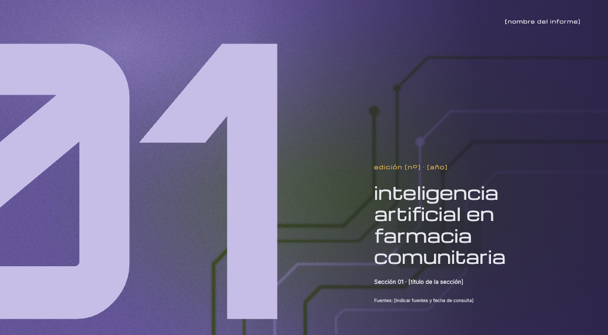

*Imágenes orientativas: al usar IA generativa, el resultado puede variar entre generaciones, según tus fuentes y con las actualizaciones de NotebookLM.*

```yaml
design_system:
  global_style:
    theme: "Tech editorial report. Duotone grainy imagery, giant cropped section numbers, bold and futuristic, a calm authority."
    typography:
      primary_heading: "Wide rounded geometric techno sans-serif (Orbitron / Michroma style), all lowercase, white-lilac"
      secondary_heading: "Same family in a small mustard edition label"
      body_text: "Clean sans-serif, small, high contrast on the dark duotone"
      numerals: "Giant section number covering 60-100% of the slide height, cropped by the left edge, in pale lilac"
      language: "the language should be what users said in the prompt"
    color_palette:
      background: "#5B4A8C violet duotone with fine film grain"
      secondary: "#3E5A1E dark green as the second duotone tone"
      text_main: "#E8E8F0"
      accent_color: "#F2B233 mustard, only for small labels"
    key_visual_elements:
      - "Duotone (violet and green) macro photography of machinery, circuitry, cables or lab equipment, with strong grain"
      - "Giant cropped numerals 01, 02, 03 as section dividers"
      - "Title block of 3-4 short lowercase lines on the right"
      - "Lots of empty duotone space, no boxes or borders"

slide_layout_templates:
  - type: "Giant_Number_Opener"
    usage: "Huge cropped number on the left, section title and edition label on the right"
  - type: "Executive_Summary"
    usage: "Short lowercase title at the bottom right, three key figures from the sources in light type"
  - type: "Duotone_Full_Image"
    usage: "Full-slide duotone photo with a single sentence"
  - type: "Data_On_Duotone"
    usage: "Thin white chart lines or large numbers over a darkened duotone image"

avoid: "bright multicolor palettes, boxes with borders, serif fonts, clip art, long paragraphs"

healthcare_rules: "Use only the provided sources. Never invent doses, indications or figures; leave a marked blank if data is missing. No real patient data. Patient-facing slides end with a small footer: Consult your healthcare professional (in the user's language)."
```
*Estado: sin probar · Archivo: [14-duotono-numeros-gigantes.md](prompts/14-duotono-numeros-gigantes.md) · Inspirado en: Estilo de informe en duotono morado con numeración gigante recortada (captura aportada por la persona que mantiene el repositorio) · Adaptación: Mantenedores del repositorio*

## F. Personajes e ilustración

### Monigote Científico

Divulgación sanitaria con un protagonista recurrente: explicar la piel, el acné, las hormonas, la microbiota o cualquier concepto con dibujos a mano

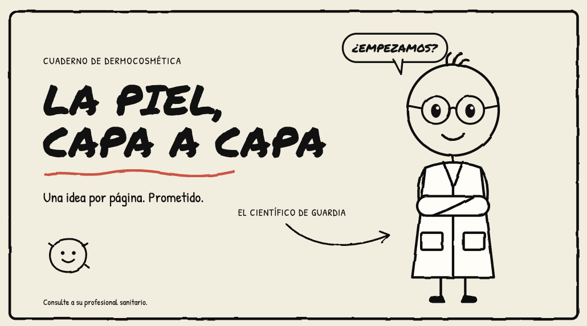 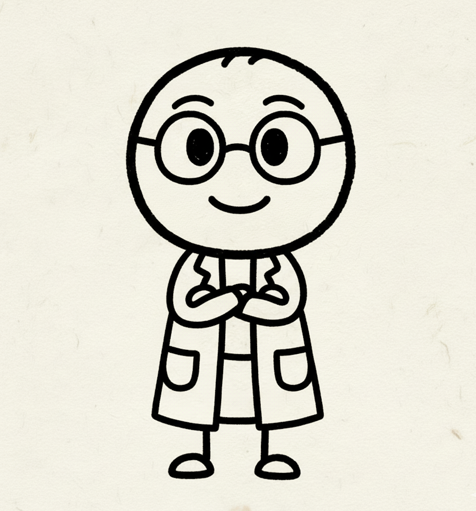

*Imágenes orientativas: al usar IA generativa, el resultado puede variar entre generaciones, según tus fuentes y con las actualizaciones de NotebookLM.*

```yaml
design_system:
  global_style:
    theme: "Hand-drawn doodle explainer. Minimalist black ink line art on cream paper, like a sketchbook. Friendly, humorous, one idea per slide."
    typography:
      primary_heading: "Bold hand-lettered uppercase block letters"
      secondary_heading: "Small hand-lettered uppercase labels with arrows, max 8 words"
      body_text: "Short hand-lettered phrases"
      language: "the language should be what users said in the prompt"
      rules: "Spell every word correctly. Never repeat a label."
    color_palette:
      background: "#F3EEDD cream paper"
      ink: "#111111 thick black outline, mostly unfilled line art"
      chalkboard: "#161616 with white chalk lettering for emphasis slides"
      accent_color: "#D94B3F tiny touches only"
    protagonist: "Recurring stick-figure scientist, always identical: huge perfectly round head with a tiny tuft of hair, round black glasses, big oval black eyes, simple smile, long white lab coat with two pockets, arms crossed, stick legs, small flat shoes. Only pose and expression change. Appears small beside each diagram, commenting on it."
    key_visual_elements:
      - "Clean cross-section diagrams (skin layers, pores) in line art with hatching"
      - "Cute mini characters with faces for bacteria, hormones and cells"
      - "Thick black frames, chalkboard or notebook-page layouts"

slide_layout_templates:
  - type: "Character_Intro"
    usage: "Large protagonist with one short title"
  - type: "Cross_Section_Diagram"
    usage: "Labelled anatomy with arrows, protagonist in a corner"
  - type: "Chalkboard_Slide"
    usage: "Dark board with white chalk title"
  - type: "Comic_Panels"
    usage: "Three framed panels for steps"

avoid: "color fills, gradients, 3D, photos, long paragraphs, misspelled words"

healthcare_rules: "Use only the provided sources. Never invent doses, indications or figures; leave a marked blank if data is missing. No real patient data. Patient-facing slides end with a small footer: Consult your healthcare professional (in the user's language)."
```
*Estado: sin probar · Archivo: [12-monigote-cientifico.md](prompts/12-monigote-cientifico.md) · Inspirado en: Estilo personal de doodle a tinta sobre papel crema con monigote científico (autoría de la persona que mantiene el repositorio) · Adaptación: Mantenedores del repositorio*

### Miniatura Tech Divulgación

Divulgación y formación sobre tecnología, IA y salud digital con portada tipo miniatura de vídeo


*Imágenes orientativas: al usar IA generativa, el resultado puede variar entre generaciones, según tus fuentes y con las actualizaciones de NotebookLM.*

```yaml
design_system:
  global_style:
    theme: "Tech explainer video thumbnail. Dark navy interface background, a friendly illustrated expert character, big bold question titles. Energetic, approachable, modern."
    typography:
      primary_heading: "Extra-bold condensed sans-serif, uppercase, huge, white and light cyan, 2-3 stacked lines"
      secondary_heading: "Heavy sans-serif uppercase inside an orange label bar with the section number, e.g. 01"
      body_text: "Light geometric sans-serif, white, 1-2 short lines as subtitle"
      language: "the language should be what users said in the prompt"
    color_palette:
      background: "#0B1F33 deep navy with faint blurred UI panels"
      primary: "#6FD3F5 light cyan"
      accent_color: "#F5A833 orange for label bars and small squares"
      secondary: "#5ED6B5 mint for icon outlines"
      text_main: "#FFFFFF"
    protagonist: "A recurring semi-realistic illustrated female presenter, wearing round glasses and a white lab coat, expressive thoughtful pose (hand on chin, pointing, thumbs up), placed on the right third of the slide. Same face, hair and glasses on every slide. Only pose and expression change."
    key_visual_elements:
      - "Rounded icon cards with thin glowing outlines (network, chat bubble, document, shield)"
      - "Large floating question mark or exclamation with small spark lines"
      - "Small pixel squares in the corners and thin gradient lines"
      - "Text on the left, character on the right, icons at the bottom-left"

slide_layout_templates:
  - type: "Thumbnail_Cover"
    usage: "Orange numbered label, stacked giant title, subtitle, two icon cards, character on the right"
  - type: "Concept_Cards"
    usage: "Three rounded icon cards joined by dotted lines with a one-word caption each"
  - type: "Character_Says"
    usage: "Large character with a short speech bubble stating one key idea"
  - type: "Step_Flow"
    usage: "Numbered orange labels linked by thin glowing lines"

avoid: "cluttered screenshots, small text, light backgrounds, cartoon mascots, stock-photo people, invented logos"

healthcare_rules: "Use only the provided sources. Never invent doses, indications or figures; leave a marked blank if data is missing. No real patient data. Patient-facing slides end with a small footer: Consult your healthcare professional (in the user's language)."
```
*Estado: sin probar · Archivo: [15-miniatura-tech-divulgacion.md](prompts/15-miniatura-tech-divulgacion.md) · Inspirado en: Estilo de miniatura de formación tecnológica con presentadora ilustrada y fondo azul noche (captura aportada por la persona que mantiene el repositorio) · Adaptación: Mantenedores del repositorio*

## Cómo contribuir

¿Tienes un estilo que te funciona? Propón uno nuevo por **issue** o **pull request**. Todos los pasos están en [CONTRIBUTING.md](CONTRIBUTING.md).

## Agradecimientos y autoría

Este repositorio nace del trabajo de la comunidad. Gracias a:

- [serenakeyitan/awesome-notebookLM-prompts](https://github.com/serenakeyitan/awesome-notebookLM-prompts), cuya estructura de prompts sirve de base a todos los estilos.
- [Kawai](https://x.com/kawai_design), [@yoshifujidesign](https://note.com/yoshifujidesign), [@mmmiyama_D](https://x.com/mmmiyama_D), [@tetumemo](https://x.com/tetumemo) y [@kottley](https://x.com/kottley), autores de los estilos originales recopilados allí.

Los prompts de este repositorio son adaptaciones al ámbito sanitario de esas estructuras. Cada estilo indica en `inspired_by` su fuente de inspiración. Si eres autor de un estilo original y quieres que se añada, cambie o retire un crédito, abre un issue.

## Licencia

- **Prompts y documentación**: [Creative Commons Atribución 4.0 (CC BY 4.0)](LICENSE). Puedes copiar, adaptar y compartir citando al repositorio.
- **Código** (carpeta `scripts/`): [MIT](LICENSE-CODE).

Cómo citar: *"Awesome NotebookLM Prompts: Salud, contribuidores del repositorio, CC BY 4.0"* + enlace.
